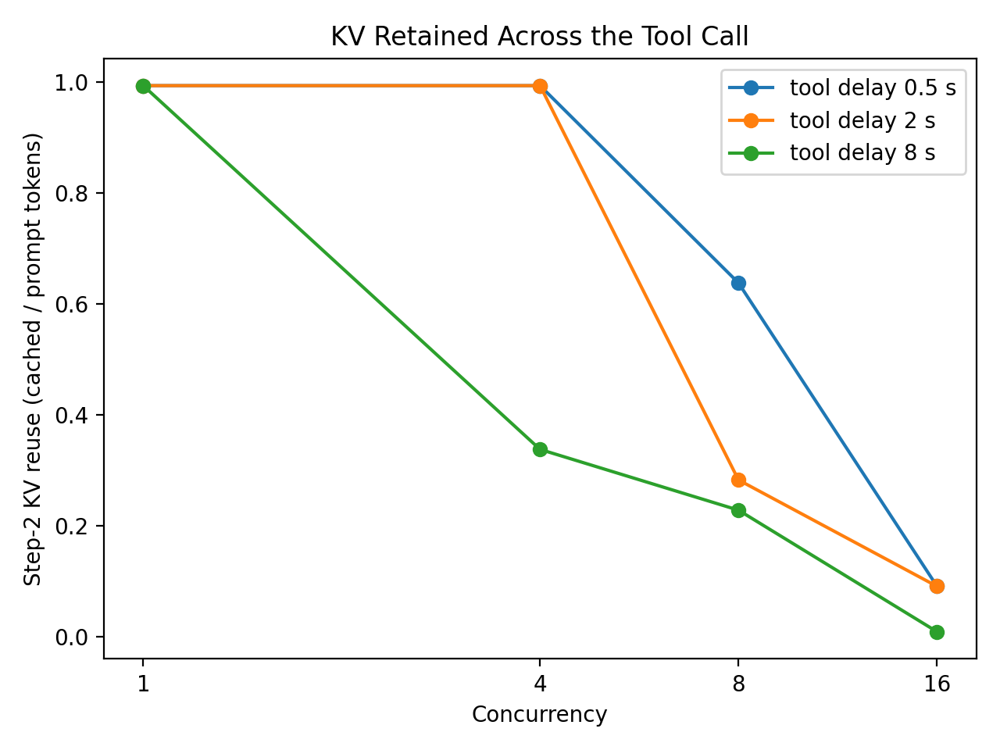
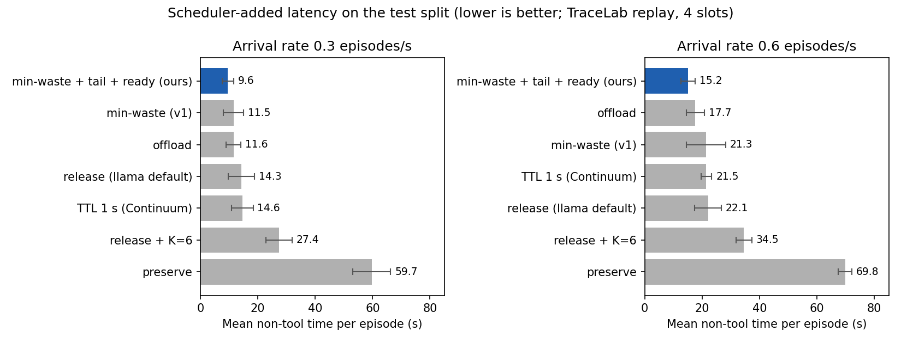

# Memory-Aware Agent Serving: Project Summary

CSE 291A, Option 1 · Hyeonung Cho, Fiona Feng, Yu-Hsuan Lin · Updated October 27, 2026

## Summary

When an agent pauses for a tool call, llama-server lets other requests overwrite its KV cache, so the agent must recompute its whole context when the tool returns. We built a scheduler that decides, at each pause, whether to keep the agent's KV in its slot, save it to disk, or let it go. Our final policy (**min-waste with tail-aware reclaim and ready-step priority**) keeps KV by default and, only when another agent needs a slot, saves the idle agent that is likely to be away longest.

On replayed real agent traces (TraceLab) with a constrained KV budget, held-out test split:

- It **cut scheduler-added latency by 31–33%** vs. llama-server's default behavior, and **13–17%** vs. the best fixed policy (always offload).
- It **avoided ~86% of prefill work**, with the same output lengths and the same answer quality.
- **Fixed settings tuned on the dev split (admission limit K = 6, a 1 s TTL) failed on the test split**, whose tool times are longer.
- On a real ReAct agent (HotpotQA), contexts are small and the KV policy barely matters. This is one of the "little benefit" cases.

All numbers are from one laptop GPU; final runs on AWS are still to do.

## 1. Why we changed direction

The original plan was **adaptive concurrency**: lower the number of concurrent tasks when memory usage is high. Two things changed that.

1. **Professor's feedback:** the idea was too simple, and evaluation used only microbenchmarks. He suggested tool calls, prefix caching, hierarchical memory (GPU/CPU/SSD), KV compression, or selective recompute, plus traces and real application runs.
2. **Phase 1 showed the idea cannot work on llama.cpp:**
   - llama-server allocates the whole KV cache at startup, so memory usage never changes with load. An adaptive-concurrency policy has no signal to act on.
   - Throughput saturates around concurrency 8–16, because the server has 8 slots and extra requests just queue inside it.
   - The bottleneck is GPU decode. Recomputing a long prompt competes with decode for the same GPU.
   - Prefix reuse is large. Before we cleared caches between trials, 3,903 of 3,904 prompt tokens were reused.

So we promoted our plan's **Potential Extension** (preserve / discard / restore KV during tool calls) to the main mechanism.

## 2. Setup

| Item | Value |
| --- | --- |
| Hardware (development) | Windows laptop, NVIDIA RTX 5070 Laptop GPU, 8 GB VRAM |
| Runtime | llama.cpp `llama-server`, build b11748 (CUDA 13.4) |
| Model | Qwen2.5-1.5B-Instruct, Q4_K_M; fixed in all comparisons |
| Memory-constrained server | 4 slots × 4,096 tokens: `-c 16384 -np 4 -ngl 99 --cache-ram 0 --slot-save-path DIR` |
| Memory tiers used | GPU slot (keep) · CPU RAM (`--cache-ram`, measured) · SSD (slot save/restore) |
| Scheduler | Our Python scheduler owns the slots and pins each request with `id_slot` |

## 3. What we built

| Component | File | Purpose |
| --- | --- | --- |
| FIFO baseline and microbenchmarks | `src/run_experiment.py`, `src/workload.py` | Phase 1 baseline, per-request logging, timeouts, VRAM, tool-delay and agent-history options |
| KV cost probe | `experiments/kv_cost_probe.py` | Cost of recompute, keep, save/restore, CPU cache, and q8_0 KV vs. context length |
| Slot pool and KV policies | `src/kv_manager.py` | Slot ownership, preserve / release / offload / TTL / min-waste, tool-time predictor, cost model |
| Trace replay | `src/agent_replay.py`, `scripts/prepare_tracelab.py` | Replays real agent traces as token-ID prompts with exact output lengths |
| Real agent | `src/react_agent.py`, `scripts/prepare_hotpotqa.py` | ReAct agent on HotpotQA with a real search tool and EM/F1 scoring |
| Analysis | `analysis/*.py` | TTFT/TPOT, idle sweep, policy comparison, fairness, answer agreement |

### Workloads

| Level | Workload | Purpose |
| --- | --- | --- |
| Microbenchmark | Four synthetic task types (short, long context, long output, multi-step) | Isolate mechanisms |
| Trace replay | 40 episodes from **TraceLab** (real Claude Code / Codex sessions), 20 dev / 20 test, 441 LLM calls | Real tool-time distributions and context growth |
| Real application | ReAct agent on 60 **HotpotQA** questions, 30 dev / 30 test | End-to-end behavior and answer quality |

TraceLab episodes were scaled to fit our model: token counts scaled proportionally so the longest conversation fits one slot (~3.6k tokens), outputs scaled to 16–128 tokens, and tool times capped at 30 s (the dataset's 95th percentile). Real tool times are heavy-tailed: median 0.25 s, p90 13.5 s, p99 180 s.

### Policies compared at each tool call

| Policy | What happens to the agent's KV |
| --- | --- |
| release | Slot is freed; KV survives only if nobody reuses the slot (llama-server's default behavior) |
| preserve | Slot stays reserved until the agent returns |
| offload | KV saved to disk, slot freed, KV restored on return |
| TTL (Continuum-style) | Slot reserved for a fixed time, then released |
| K = 6 | Release, plus at most 6 agents admitted at once (best fixed admission limit on dev) |
| **min-waste + tail + ready (ours)** | Keep KV by default. When a slot is needed and none is free, offload the idle agent with the longest expected remaining tool time. Once an agent has waited past its predicted time, the time already waited is used as its remaining time, because long tool calls tend to keep running. Agents returning from tools get slots first, with aging so new agents do not starve. |

## 4. Phase 1 results

**Concurrency baseline (team runs, cleared caches).** Throughput rises with concurrency and flattens past 8, because the server has 8 slots. On Hyeonung's machine it went from 0.27 to 0.90 tasks/s (~1k-token context), and on Fiona's from 0.44 to 1.50. Longer contexts lower throughput.

**KV cost on the laptop GPU** (`results/kv_cost/summary.md`):

| Context | Recompute | Keep in slot (prefill new suffix only) | Save to disk | Restore from disk |
| --- | --- | --- | --- | --- |
| 1,024 tokens | 128 ms | 14 ms | 21 ms | 13 ms |
| 4,096 tokens | 573 ms | 15 ms | 75 ms | 52 ms |

KV size is 28 KB per token (f16), matching the formula. q8_0 halves it. Saving and restoring costs about 4–5x less than recomputing. On teammates' machines, recompute was 5–10x slower, so avoiding it matters even more there.

**KV is lost during tool calls** (`results/idle_sweep/`). The chart shows the share of step 1's KV still reusable at step 2:



At concurrency 16, only 1–9% survives. With an 8 s tool delay, only 34% survives even at concurrency 4. Each lost context costs a ~2,800-token recompute (about 20x slower prefill).

## 5. Phase 2 results

### Trace replay, test split (`results/replay/summary.md`)

The chart shows mean non-tool time per episode: completion time minus the episode's own tool time, which is the part the scheduler controls.



| Policy | Rate 0.3: p50 completion / non-tool (s) | Rate 0.6: p50 completion / non-tool (s) | Prefill tokens (rate 0.6) |
| --- | --- | --- | --- |
| release (default) | 32.9 / 14.3 | 42.7 / 22.1 | 280k |
| release + K=6 | 48.3 / 27.4 | 59.5 / 34.5 | 75k |
| preserve | 90.4 / 59.7 | 101.0 / 69.8 | 38k |
| offload | 27.8 / 11.6 | 35.2 / 17.5 | 38k |
| TTL 1 s | 38.3 / 14.6 | 47.5 / 21.5 | 119k |
| **ours** | **26.5 / 9.6** | **31.5 / 15.2** | **38k** |

Offload and ours are from the same session. Ours also saved to disk 44–63% less often than offload, because it saves only when a slot is actually needed. It was selected on the dev split and run on the test split once.

### Cases where the policy should help little

| Case | Result |
| --- | --- |
| Low load (0.15 episodes/s) | Release (26.8 s p50) and TTL (28.6 s) are best; the default is fine, and K = 6 variants only add 5–7 s of queueing |
| No memory pressure (8 slots) | Release and TTL best; KV policy has nothing to fix |
| Short tools (tool time × 0.1) | Keeping KV helps the most (p50 17–20 s vs. 45 s for release) |
| Real ReAct agent (small contexts) | See below |

### Real ReAct agent on HotpotQA (`results/react/summary.md`)

Contexts average only ~900 tokens and about 3 LLM calls per question, so recompute is cheap. Contention appears only at ≥ 2 questions/s. Our policy was fastest at 2 questions/s (non-tool time 1.33 s vs. 1.39 s for release) and close to release at 4. Offload cut prefill work by up to 31%. Preserve and K = 6 were clearly worse.

### Validity checks

- Every trace-replay run produced exactly the target output lengths (no policy gains by generating less).
- On HotpotQA, exact match was 0.14–0.19 under every policy. Answers differ across policies about as often as a policy differs from itself across runs (~72% agreement), which reflects GPU nondeterminism at temperature 0, not the policy.
- Policy decision overhead is about 3–9 µs per pause.
- Long episodes were not starved: ready-step priority uses aging, and the longest third of episodes had the lowest non-tool time under our policy (12.4 s at rate 0.3 and 17.0 s at rate 0.6, vs. 14.4 s and 19.1 s for offload and 17.5 s and 23.5 s for release).

## 6. Conclusions

1. **The dominant memory problem for agents on llama.cpp is not running out of VRAM**, which is preallocated. It is **losing KV during tool calls**, which turns cheap appends into full recomputes.
2. **Keeping KV across tool calls matters, and how it is kept matters.** Reserving slots wastes them during long tools; overwriting them wastes compute. On-demand offloading of the longest-idle agent gets the benefit of both.
3. **Heavy-tailed tool times break naive prediction.** An average-based predictor underestimates long calls. Using the time already waited fixed this.
4. **Tuned fixed settings are fragile.** K = 6 and TTL looked best on dev and failed on test.
5. **Benefits depend on context size and load.** With small contexts or little contention, the default behavior is already good enough.

## 7. Limitations

- All results come from one laptop GPU. Recompute is cheap here (~0.14 ms/token), and on slower hardware the gains should be larger.
- Disk save/restore was measured with a warm OS file cache; cold SSD reads will be slower.
- Dev and test splits have only 20 trace episodes each, and tool times are heavy-tailed, so tuned parameters are fragile.
- TraceLab episodes were scaled down (tokens, outputs, 30 s tool cap), which changes the ratio of recompute cost to wait time.
- The 1.5B model is a weak HotpotQA agent (EM ≈ 0.17), which limits the quality check.
- The CPU-RAM tier was characterized but not used as a policy target.

## 8. Remaining work

1. Run the final evaluation on the AWS GPU instance: re-measure the KV cost model there, then rerun the test-split comparison.
2. Optional: a cold-SSD restore measurement, and a run with KV quantization (q8_0) to double slot capacity.
3. Final report.

## Reproducing

```
# llama-server with the constrained KV budget
llama-server -m qwen2.5-1.5b-instruct-q4_k_m.gguf --port 8090 -c 16384 -np 4 -ngl 99 --cache-ram 0 --slot-save-path DIR

# Trace replay with our policy (test split)
python -m src.agent_replay --policy min_waste --tail-aware --ready-priority --split test --arrival-rate 0.6 --trials 5 --save-dir DIR

# Real agent
python -m src.react_agent --policy min_waste --tail-aware --ready-priority --split test --arrival-rate 2 --trials 3 --save-dir DIR

# Compare policies
python analysis/compare_policies.py results/replay/test
```

## Data sources and related work

- **TraceLab** coding-agent trace dataset, SyFI Lab, University of Washington, CC BY 4.0 ([tracelab.cs.washington.edu](https://tracelab.cs.washington.edu)).
- **HotpotQA**, Yang et al., EMNLP 2018, CC BY-SA 4.0 ([hotpotqa.github.io](https://hotpotqa.github.io)).
- **Continuum**: KV cache time-to-live for multi-turn agents ([arXiv 2511.02230](https://arxiv.org/abs/2511.02230)); our TTL baseline.
- **InferCept**: preserve / discard / swap and min-waste for augmented LLMs; the basis of our policy.
